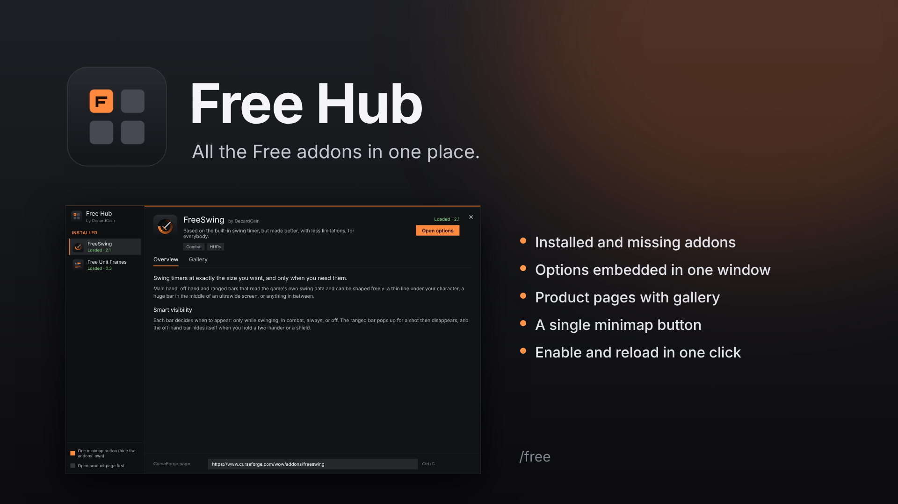
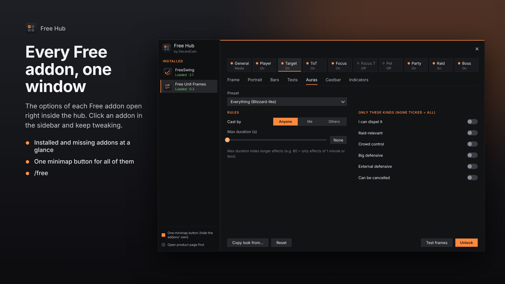
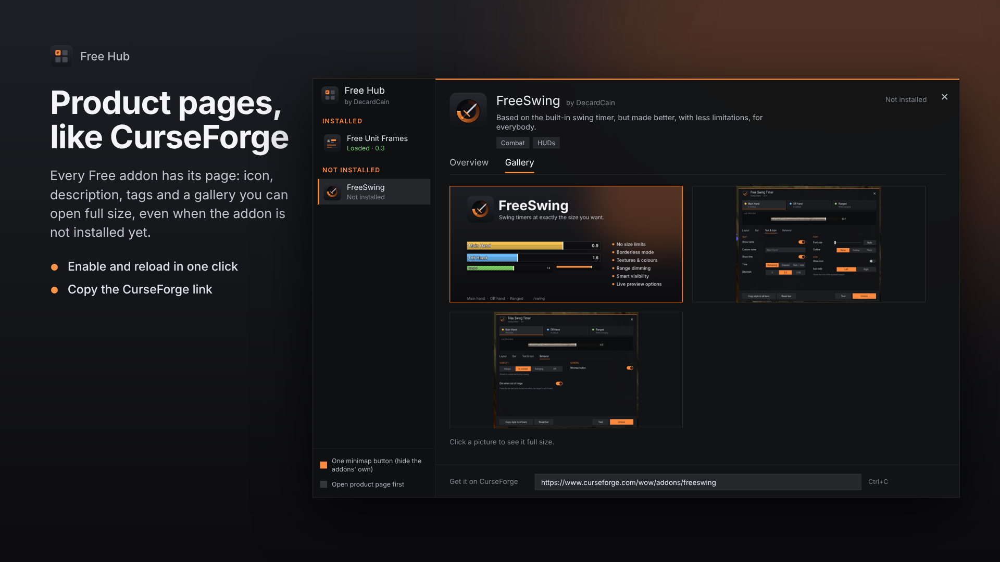
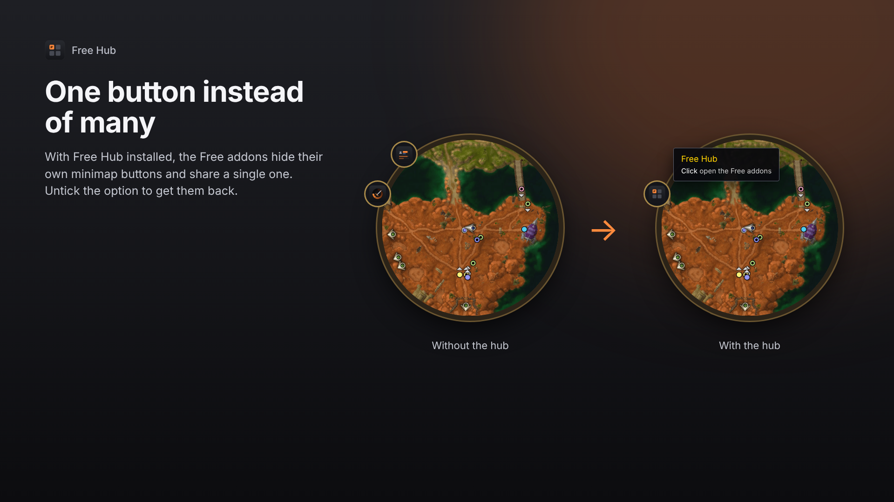

<h1 align="center">Free Hub</h1>

All the Free addons in one window: options side by side, product pages with gallery, and a single minimap button.

<a href="https://www.curseforge.com/wow/addons/free-hub"><b>Download on CurseForge</b></a> · version <b>1.5.6</b> · WoW Forever (1.60.1) · <code>click the minimap button</code>

## Screenshots

<table>
<tr>
<td width="50%" valign="top"> <b>Options in one window</b> Click an addon in the sidebar and its options open right inside the hub.</td>
<td width="50%" valign="top"> <b>Product pages</b> Icon, description, tags and gallery for every Free addon, even when it is not installed.</td>
</tr>
<tr>
<td width="50%" valign="top"> <b>One minimap button</b> The Free addons share a single button instead of one each.</td>
</tr>
</table>

**One window for all the Free addons.**

Free Hub gathers every Free addon (Free Unit Frames, Free Bars, FreeSwing, Free Minimap, Free Guild, Free LFG) in a single window. A sidebar lists what you have and what you don't. Click an installed addon and its options open on the right, without juggling separate windows or commands.

## What it does

| Feature | Details |
|---|---|
| **Sidebar** | Installed addons first, then the ones you don't have yet, each with its state (Loaded, Disabled, Not loaded, Not installed) and version. |
| **Options inside the hub** | Every installed Free addon opens its options right next to the sidebar. Their usual commands (`/fuf`, `/fb`, `/swing`, `/fmm`, `/fg`, `/flfg`) open the hub on the right page. |
| **Resizable window** | Drag the bottom-right corner: the options spread out to use the room. The hub remembers its size and position. |
| **Product pages** | Like CurseForge: icon, author, summary, tags, a description and a gallery you can open full size. Also available for addons you haven't installed yet. |
| **Enable and reload** | Addon installed but disabled? One button enables it and reloads the UI. |
| **CurseForge link** | Each page shows the addon's CurseForge address, ready to copy with Ctrl+C. |
| **One minimap button** | The Free addons hide their own minimap buttons and share Free Hub's. Untick the option to get them back. |

## Commands

- `/free` or `/freehub` — open the hub
- Click the minimap button — open or close the hub

## Options

At the bottom of the sidebar:

- **One minimap button (hide the addons' own)**
- **Open product page first** — open on the addon's page instead of its options

## Notes

- Free Hub doesn't download or update anything: install the Free addons from CurseForge as usual.
- Each Free addon still works on its own without Free Hub.
- Built for WoW Forever.

## The Free suite

Addons for WoW Forever that share the same look, profiles and a single minimap button through Free Hub.

| | Addon | |
|---|---|---|
|  | **[Free Hub](https://github.com/DecardCainSuite/FreeHub)** (this one) — All the Free addons in one window: options side by side, product pages with gallery, and a single minimap button. | [CurseForge](https://www.curseforge.com/wow/addons/free-hub) |
|  | **[Free Unit Frames](https://github.com/DecardCainSuite/FreeUnitFrames)** — Fully customisable unit frames for player, target, focus, party, raid and bosses, with an ElvUI-style preset in one click. | [CurseForge](https://www.curseforge.com/wow/addons/freeunitframes) |
|  | **[Free Bars](https://github.com/DecardCainSuite/FreeBars)** — Up to 9 action bars, laid out as a grid or an arc, with mouseover fade, paging and a clean flat look. | [CurseForge](https://www.curseforge.com/wow/addons/freebars) |
|  | **[Free Swing](https://github.com/DecardCainSuite/FreeSwing)** — Swing timers for main hand, off hand and ranged, at exactly the size and style you want. | [CurseForge](https://www.curseforge.com/wow/addons/freeswing) |
|  | **[Free Minimap](https://github.com/DecardCainSuite/FreeMinimap)** — A rectangular minimap of any size, with a region map drawn from the game's own terrain tiles around you. | [CurseForge](https://www.curseforge.com/wow/addons/freeminimap) |
|  | **[Free Guild](https://github.com/DecardCainSuite/FreeGuild)** — Guild roster and rank tool for guild masters and officers: filters, bulk ranks, rules that promote for you, stats, raid rosters with attendance, guild info and notes. | [CurseForge](https://www.curseforge.com/wow/addons/freeguild) |
|  | **[Free LFG](https://github.com/DecardCainSuite/FreeLFG)** — The group finder as a compact, sortable table: leader, roles, free slots, one-click whisper from a template, and live filters you write yourself. | [CurseForge](https://www.curseforge.com/wow/addons/freelfg) |

## Changelog

What is new in the current version: [CHANGELOG.md](CHANGELOG.md). Full history: [CHANGELOG-history.md](CHANGELOG-history.md).

## Repository layout and releases

- The repository root is the addon folder (`FreeHub/`), as installed in `Interface\AddOns`.
- `curseforge/` holds the CurseForge page: `description.md` (fields, gallery captions, description) and `images/` (logo, gallery, social preview). It is not shipped in the addon zip.
- `CHANGELOG.md` holds the notes of the version being prepared; they are sent to CurseForge as the file's changelog.
- Releasing: bump `## Version` in `FreeHub.toc`, write `CHANGELOG.md`, then publish a GitHub release named `v<version>`. GitHub Actions packages the addon with the [BigWigs packager](https://github.com/BigWigsMods/packager) and uploads it to CurseForge and to the GitHub release.

Bug reports and ideas are welcome in the issues or in the CurseForge comments.
